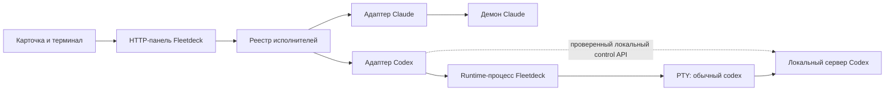

# Поддержка Claude Code и Codex в Fleetdeck

Дата: 2026-11-04. Статус: проект для обсуждения, реализация не начата. База: `origin/master`, `8440d9cc0ad525dd76328b6d820a9309a9f0ca8d`. Проверенная локальная версия: `codex-cli 0.166.0`; это исследовательская база, а не автоматически выбранная минимальная поддерживаемая версия.

## 1. Цель и границы

Пользователь выбирает Claude Code или Codex для карточки. Оба исполнителя работают в одном флоте: получают задачу, показывают состояние, принимают сообщения, предоставляют настоящий интерактивный терминал, продолжают сессию с историей, участвуют в локальном ревью и оставляют результат в архиве. Существующие карточки, настройки и работа Claude сохраняют поведение.

Полная поддержка означает весь рабочий цикл Fleetdeck для управляемых им сессий, а не побайтовое совпадение возможностей двух продуктов. Недоступные модель, лимиты и состояние обозначаются явно; неизвестность не превращается в нулевое потребление или отсутствие вопроса.

Первый выпуск поддерживает один настроенный источник каждого исполнителя на экземпляр панели и несколько флотов. Произвольное подключение живого терминала сессии, запущенной вне Fleetdeck, перенос внутреннего контекста Claude ↔ Codex, удалённые машины и новые операционные системы в этот объём не входят. Сохранённую внешнюю сессию Codex можно будет импортировать только после отдельной проверки эксклюзивного владения; наличие истории само по себе не даёт права запускать второго писателя.

## 2. Текущее устройство

| Область | Точка в коде | Зависимость от Claude |
| --- | --- | --- |
| Запуск | `internal/orchestrator/start.go`, `launch.go` | `claude --bg`, короткий ID, модель `opus`, режимы Claude |
| Выдача задачи | `internal/orchestrator/dispatch.go` | Порядок уже корректный: запуск без задачи → запись связи → отправка; список типизирован как `daemon.Session` |
| Терминал | `internal/server/pty.go`, `web/js/liveterminal.js` | Общий интерфейс `Terminal` уже есть; attach, ошибки и эвристика размера завязаны на демон Claude |
| Сбор состояния | `cmd/fleetdeck/collect.go`, `internal/state/snapshot.go` | Демон, `jobs`, statusline и транскрипты Claude |
| История и восстановление | `internal/jobs`, `internal/transcript`, `internal/daemon/resume.go` | Форматы и протокол Claude |
| Карточки | `internal/board/card.go`, `create.go`, `write.go` | `session` хранит короткий ID, поля исполнителя нет |
| Флоты и настройки | `internal/fleet`, `internal/config`, `cmd/fleetdeck/fleets.go` | Один `agent`, единые параметры запуска Claude, закрепления и подписи сессий |
| Ревью и завершение | `internal/server/review.go`, `internal/orchestrator/cleanup.go` | Git-часть общая; сообщения, рабочий каталог и последнее слово получают через Claude |
| Инструкции | `plugin/skills/fleet-orchestrator`, `card-keeping` | Прямые обращения к `claude-agents` и соглашение о коротком ID |

`daemon.Session.Agent` — имя определения роли Claude, а не исполнитель или модель. Использовать это поле как признак Codex нельзя. `Session.Backend` также не переопределяется без учёта его существующего значения.

Основные существующие инварианты: отказ при устаревшей записи карточки; различение записи файла и неудавшегося коммита; запись ссылки на сессию до передачи задачи; чтение результата и запись архива до остановки сессии. Все четыре сохраняются.

## 3. Выбор способа интеграции

| Вариант | Преимущество | Цена и ограничение | Решение |
| --- | --- | --- | --- |
| Обычный `codex` в управляемом PTY | Настоящий привычный терминал, настройки локального CLI | Требуются владение PTY, связь с thread и структурированные состояния | Основной кандидат; обязательный прототип до основной реализации |
| Собственный App Server и TUI с `--remote` | Явный общий сервер для API и терминального клиента | Дополнительный жизненный цикл сервера; совместная работа клиентов требует проверки | Резервный вариант при документированном провале основного |
| `codex exec` или SDK без TUI | Удобный программный запуск | Не предоставляет запрошенный интерактивный терминал Codex | Не подходит как единственная интеграция |

Исходный запуск — `codex` без `--remote` и без принудительного `--no-daemon`. Обычный CLI может использовать общий локальный сервер; отсутствие `--remote` не означает отсутствие App Server. Fleetdeck не перезапускает и не перенастраивает общий сервер пользователя.

Управление и терминал разделены: терминальные байты идут через PTY, а сведения о сессии и доставка задачи — через проверенный локальный протокол и/или события hooks. Экран TUI не является источником структурированного состояния. `--no-alt-screen` не задаётся без необходимости: оба режима проверяются, основной следует пользовательским настройкам.

Это выбор направления, а не утверждение, что вся комбинация уже работает. Если обычный запуск не позволяет надёжно связать thread, сообщения и состояния, этап 0 завершается описанием ограничения и пересмотром транспорта. Нельзя незаметно заменить его `--remote` или объявить урезанный вариант полной поддержкой.

## 4. Общая модель исполнителя

Добавить `internal/executor`: общие типы, реестр двух адаптеров, проверка возможностей и маршрутизация. Адаптер Claude оборачивает существующие `daemon`, `jobs`, `transcript` и usage; адаптер Codex располагается в `internal/codex`. Эти пакеты не импортируют HTTP-сервер или интерфейс страницы. `internal/state` получает нормализованные значения, а не встраивает `daemon.Session` в общую модель.

Контракт задаёт операции `Start`, `List`, `Send`, `Interrupt`, `Stop`, `Resume`, `OpenTerminal`, `History` и `LastWords`. Это границы ответственности, а не требование одного большого Go-интерфейса: сервер и диспетчер получают только используемые ими функции, по существующему стилю `Deps`. Операции возвращают типизированные ошибки: исполнитель недоступен, запуск не завершён, конфликт, доставка неизвестна, сессия не восстанавливается, функция не поддерживается.

`Interrupt` прекращает текущий ход; `Stop` останавливает работу с сохранением истории. Закрытие терминала — отдельная операция отключения клиента. Эти действия не взаимозаменяемы.

Нормализованная сессия содержит `key`, `executor`, `nativeId`, `name`, `cwd`, `model`, `lifecycle`, `activity`, `needsHuman`, `reason`, `observedAt` и capabilities. Поля модели, контекста, стоимости и лимитов допускают отсутствие и содержат источник/свежесть. `needsHuman` сохраняет три значения: да, нет, неизвестно. Сведения о подключении терминала не подменяют сведения о работе агента.

Capabilities описывают фактически доступные действия: терминал, ввод, структурированная отправка, interrupt, stop, resume, история, контекст и лимиты. Недоступность Codex не отключает Claude и доску. Реестр сообщает состояние каждого адаптера отдельно; сборщик применяет независимые таймауты и сохраняет последний снимок с отметкой устаревания.

## 5. Идентификаторы, карточки и совместимость

Для Codex Fleetdeck выделяет собственный UUID запуска до старта процесса. Внешний ключ имеет вид `codex:<runtime-uuid>`; ID thread хранится отдельно и появляется после регистрации. Ключ остаётся прежним при возобновлении того же thread. Новая работа или fork получает новый ключ. Нативный thread ID, session ID дерева субагентов и PID не считаются одним идентификатором.

Старые Claude short ID остаются допустимыми и означают Claude. Внутренний resolver преобразует их в типизированную ссылку, сохраняя существующее внешнее представление. Новые Codex ключи не ищутся через Claude daemon. Ссылки на сессии в карточках, закрепления оркестратора, labels, архив и маршруты используют один resolver. Для labels сохраняется чтение прежнего ключа по Claude UUID; новые записи Codex используют составной ключ. Коллизии нативных ID разных исполнителей не объединяют сессии.

Пример нового frontmatter; UUID здесь условный:

```yaml
executor: codex
session: "codex:00000000-0000-4000-8000-000000000001"
```

`executor` выбирает запуск, `session` указывает на конкретный запуск. Отсутствующее поле `executor` у существующей карточки означает `claude`, даже если позже изменится настройка для новых карточек. Новые карточки явно записывают выбранное значение. Неизвестное значение или противоречие `executor` и `session` блокирует запуск и показывает ошибку; автоматического отката на Claude нет.

Парсер, создание, точечная запись, Python-скрипты шаблона и валидатор обновляются вместе. Изменение `executor` разрешено только у карточки без связанной сессии, с проверкой ожидаемых значений `executor` и `session` под одной блокировкой. Отсутствующее старое поле добавляется аккуратно, с сохранением остального frontmatter. Общая функция записи не получает право произвольно менять любые поля.

Формат ключа меняется также в поле `session` документов доски: `internal/board/docmeta.go` и документная ветка `validate_cards.py` сейчас принимают только 6–12 hex-символов. Авторство документов Codex и открытие его терминала из вкладки документа входят в полный цикл. Обновление живых досок выполняется через существующий механизм `plugin/scripts/upgrade-board.sh`; до обновления валидатора запуск Codex на такой доске блокируется с понятной причиной. Это не требует переписывать существующие карточки или документы.

После начала работы исполнитель неизменяем. Передача другому исполнителю оформляется новым запуском после явного завершения/отвязки прежнего; результат прежней работы остаётся доступен. Перенос внутреннего контекста не обещается.

Новая версия читает старые данные без массовой миграции. Старый Fleetdeck не поддерживает Codex-ссылки; downgrade при наличии таких карточек не считается совместимым и должен быть явно описан в release notes. Новые поля API добавляются с сохранением старых Claude aliases на переходный период. Переход страницы на новые ключи и изменения серверных маршрутов выпускаются согласованно.

## 6. Владение PTY и процессами

Добавить служебный режим существующего бинарника Fleetdeck для runtime-процесса Codex. Он запускается независимо от HTTP-панели и окна, владеет PTY и дочерним `codex`, читает вывод даже без браузера и обслуживает приватный Unix socket. Отдельный исполняемый файл не нужен, но режим включается в упаковку, диагностику и проверки обновления приложения.



Пунктирная связь и использование локального сервера подтверждаются на этапе 0; диаграмма не устанавливает новый недокументированный протокол.

Runtime хранит версию протокола, собственный UUID, PID и признаки идентичности процесса, session/thread ID, CWD, параметры запуска без секретов, привязку к доске/карточке, состояние и журнал выдачи задачи. Данные находятся в отдельном приватном каталоге Fleetdeck с правами `0700`, файлы и socket — `0600`. Запись атомарная, один runtime на ключ, создание защищено межпроцессной блокировкой. PID без проверки socket handshake и идентичности не доказывает владение.

Членство Codex-сессии во флоте задаётся при запуске через канонический путь доски, а не выводится только из CWD: один репозиторий может обслуживаться несколькими флотами. Проверка членства выполняется для управления и терминала. Discovery общего сервера не добавляет все найденные thread в управляемый флот.

При перезапуске панель обнаруживает runtime и подключается к нему; новый `codex` не запускается. Завершение панели, закрытие окна и закрытие WebSocket не отправляют SIGHUP агенту и не закрывают master PTY. Сам runtime не обновляется внутри работающего процесса: текущий экземпляр заканчивает работу своим протоколом, новый бинарник создаёт новые runtime. Панель поддерживает текущую и предыдущую версии протокола; несовместимый runtime показывается с объяснением и не останавливается автоматически.

Если runtime погиб, сохранённая история позволяет предложить `Resume`; это новый PTY с прежним thread, а не обещание непрерывного терминала. Неизвестное состояние живого процесса запрещает автоматический повторный запуск. Сбой общего сервера Codex отображается отдельно; Fleetdeck не чинит его командой restart без отдельного действия пользователя.

### Терминальные соединения

Использовать существующий поток binary frames и сообщения resize. Сохранить origin check, отдельную аутентификацию терминала и ограничения размеров. Ошибки и завершение потока нормализовать: различать конец сессии, временный разрыв и недоступный runtime; исключения `daemon.ErrKicked` остаются внутри адаптера Claude.

Для одного PTY допускается один активный писатель; остальные подключения только читают. Размер задаёт писатель, а при его отсутствии первый активный наблюдатель. Передача права ввода явная, старое соединение получает обновление `writable`; два окна не меняют размер друг другу по кругу. Claude сохраняет существующую политику attach.

Сохраняется существующее правило страницы: закреплённый оркестратор открывается в своей колонке, его второй терминал не монтируется внутри карточки или вкладки документа. Политика единственного писателя дополнительно защищает отдельные браузерные вкладки.

Runtime непрерывно читает PTY, ограничивает очередь каждого клиента и отключает отставшего клиента без остановки агента. Для восстановления картинки нужен корректный снимок терминального состояния или доказанный repaint. Один кольцевой буфер произвольного хвоста ANSI не восстанавливает экран надёжно. На этапе 0 выбрать и измерить реализацию: ограниченный буфер плюс гарантированный repaint Codex либо терминальная модель со снимком. При отсутствии надёжного восстановления терминала этап не проходит.

Эвристика `followSize` из текущего `liveterminal.js` основана на измерениях отрисовки Claude. Для Codex она отключена через capability; используются явный fit и resize владельца. Проверяются fullscreen и inline, Unicode, вставка многострочного текста, bracketed paste, Ctrl-C, смена шрифта и возврат скрытой вкладки. Управляющие последовательности терминала не дают агенту права на автоматическое открытие ссылок или доступ к clipboard.

## 7. Регистрация, состояния и доставка

Измеренный кандидат регистрации — `thread/start` через локальный control API, затем `thread/name/set` для сохранения пустой истории и обычный `codex resume <id>` внутри PTY. В CLI 0.166.0 один `thread/start` ещё не обеспечивает успешный TUI resume; добавление имени обеспечило запуск без обращения к модели. Этот путь не использует `--remote`. До выбора его для продукта обязательны проверки двух запусков, владения и восстановления. Резервный источник регистрации — hook `SessionStart` с выделенным runtime nonce в окружении. Поиск самой новой сессии в CWD не допускается.

Hooks служат наблюдателями и не меняют решения агента или approvals. Их доверие проходит штатный механизм Codex; Fleetdeck не добавляет флаг обхода доверия. Setup объясняет необходимость доверия и показывает готовность интеграции. Если hooks являются необходимым источником регистрации, запуск карточки до их готовности блокируется. Глобальные файлы пользователя не перезаписываются; установка интеграции выполняется отдельным явным действием setup.

Hooks могут дополнять control API, но не заменяют его по умолчанию. Их покрытие и различение родительского thread и субагентов проверяются: событие дочернего агента не должно переводить карточку родителя в `idle` или заменять ID. Неизвестные события игнорируются с диагностикой версии, без вывода секретов и полного содержимого инструментов.

| Состояние | Основание |
| --- | --- |
| `starting` | Runtime создан, регистрация или готовность ещё не подтверждены |
| `working` | Подтверждён активный ход; отсутствие вывода не означает остановку |
| `idle` | Источник подтвердил завершение хода и готовность принимать следующий |
| `waiting` | Есть подтверждённый вопрос или запрос разрешения человеку |
| `stalled` | Известная ошибка авторизации, лимита или исполнения |
| `unknown` | Источник недоступен, устарел или не позволяет сделать вывод |

Отдельный `lifecycle`: `live`, `stopped`, `dead`. Потеря связи переводит наблюдение в `unknown`, а не сессию в `dead`. Ответ агента не завершает карточку автоматически; правила стадии доски сохраняются. При восстановлении источника выполняется повторная сверка состояния, а не только ожидание следующего hook.

Измерение совместной работы API/TUI показало, что approval для API-issued turn приходит API-клиенту, а наличие TUI не гарантирует диалог подтверждения в терминале. Поэтому runtime владеет запросами разрешений и ввода для своих ходов; панель предоставляет явное действие ответа рядом с терминалом. Решение пользователя содержит конкретный запрос, его ревизию и выбранный ответ; автоматического разрешения нет. Нельзя использовать только JSON-RPC ID как постоянный ключ: допустим ID `0`, а при переподключении идентификаторы относятся к новой связи. Привязка проверяется по thread/turn/item/approval ID; устаревший или уже разрешённый ответ отклоняется.

После потери API-соединения `thread/resume` на новом соединении воспроизвёл ожидающий approval; ответ `cancel` завершил тестовый ход как `interrupted`. Это подтверждает кандидат восстановления запросов, но не заменяет проверку успешного approve, пользовательского ввода и одновременного ответа двух клиентов. Пока они не пройдены, gate этапа 0 остаётся открытым.

Кандидаты отправки: структурированный метод локального сервера через проверенное подключение или `codex queue`. Выбирается один основной путь для поддерживаемой версии, с проверкой принятого сообщения. Клавиши PTY предназначены для человека; автоматическая отправка текста с Enter не считается надёжным основным каналом, поскольку фокус может находиться в диалоге.

Отправка различает `queued`, `accepted`, `failed` и `unknown`. Успешный exit code команды не равен принятию задачи. При отсутствии подтверждения интерфейс сообщает неопределённость и не повторяет задачу автоматически. Возобновление из `queue --resume` также проверяется отдельно.

## 8. Сквозной запуск карточки

1. Проверить карточку, CWD, executor и capabilities. Получить межпроцессный lock по каноническому пути доски и ID карточки, перечитать ожидаемую ревизию. Существующий mutex диспетчера сам по себе не защищает две панели.
2. Сохранить намерение запуска с уникальным operation ID. Создать runtime без пользовательской задачи; приветственные инструкции и setup допустимы, исполнение карточки — ещё нет.
3. Получить регистрацию и доказательство готовности конкретной сессии. Зафиксировать соответствие runtime ↔ native thread ID.
4. Записать `session` с проверкой прежнего значения, затем `stage`, сохраняя существующие сообщения о частично выполненных шагах и очереди коммитов.
5. Доставить ссылку на карточку и инструкции через основной структурированный канал. Подтверждение принятия сохранить в журнале операции; только после этого показывать задачу выданной.

Если файл записан, а git-коммит отложен или не удался, повторный запуск не производится: фактическая связь уже существует. Если запись связи не удалась, runtime остаётся видимым как неподвязанный, задача не отправляется. Ошибка после запуска всегда возвращает его ключ пользователю.

Lock координирует писателей Fleetdeck; сторонний редактор или агент, не соблюдающий его, остаётся внешним конкурентом. Поэтому сохраняется проверка ожидаемых полей непосредственно перед записью и запрет для агента менять связь сессии. Гарантия транзакции над всеми произвольными редакторами Markdown не заявляется.

Сбой между отправкой и фиксацией подтверждения означает `delivery unknown`: сверить историю по operation ID/идентификатору сообщения, если источник позволяет. При отсутствии доказательства оставить явное действие пользователя. Exactly-once доставка без поддержки runtime не обещается. Повтор HTTP-запроса с тем же operation ID возвращает существующую операцию; новая операция для уже связанной карточки отклоняется.

## 9. Настройки и интерфейс

Добавить `executors.codex` с `enabled`, argv команды, необязательными абсолютным `home` и именем `profile`, моделью, sandbox и approval policy. `home` означает явно выбранную установку `CODEX_HOME`, а не новый пустой каталог, создаваемый ради изоляции. Учётные данные остаются у Codex. Команда запускается как argv без shell; поиск бинарника использует `internal/userenv`, в том числе запуск приложения из Dock.

Существующие `agent` и `workers` остаются настройками Claude. Они не преобразуются в Codex-параметры. Для новых карточек настройка `default_executor` по умолчанию равна `claude`; форма сохраняет конкретное значение. При отсутствии явно заданной модели Codex использует собственную конфигурацию. Модель `opus`, режим `auto` и отключённый sandbox Claude не наследуются. Пользователь видит эффективные ограничения Codex до запуска; Fleetdeck не расширяет их автоматически.

Форма создания и карточка без сессии получают выбор исполнителя. Недоступный Codex виден с причиной и переходом к setup. Выбор не меняется молча. Активная карточка и список сессий показывают исполнителя отдельно от модели и роли; поля связывания и редактирования работают по непрозрачному ключу.

При наличии Claude Codex необязателен, и наоборот: setup проверяет интеграции независимо. Отсутствие Anthropic OAuth не препятствует работе Codex. Лимиты каждого аккаунта показываются отдельно с источником и временем обновления; нельзя суммировать лимиты разных поставщиков. Недоступные метрики отображаются как недоступные.

Дополнить API описанием исполнителей и готовности интеграции. Маршруты сессий принимают общий ключ, корректно кодируют его в URL и проверяют принадлежность флоту. Старые Claude-маршруты продолжают обслуживаться resolver. WebSocket snapshot содержит общие состояния и capabilities; интерфейс не угадывает исполнителя по длине ID или строке модели. Добавить русские и английские сообщения.

## 10. Оркестрация, ревью и завершение

Диспетчер выбирает адаптер из карточки. Оркестратор сам может работать в Claude или Codex и выдавать задачи обоим через общий API Fleetdeck. Для этого нужен одинаковый доступный интерфейс команд Fleetdeck с машинным результатом запуска, отправки, состояния и восстановления; точный CLI-контракт фиксируется до адаптации навыков. Доступ защищается локальной аутентификацией, а не обходом проверок терминала.

Навыки `fleet-orchestrator` и `card-keeping` обновляются для обоих исполнителей: убирается обязательность `claude-agents`, документируются общий ключ сессии, порядок выдачи задачи, владение полями и ошибки доставки. Codex получает совместимую упаковку инструкций без подмены Claude-инструментов несуществующими аналогами. Основная инструкция хранится в одном источнике, специфичные команды — в адаптерах. Установка не переписывает проектный `AGENTS.md` и пользовательские навыки без отдельного выбора.

Git-дифф и комментарии локального ревью остаются общими. Рабочий каталог получают через выбранный адаптер и существующие ограничения доступа; ответ на ревью доставляется в связанную сессию. Установленное агентом поле `worktree` не заменяется произвольным CWD из браузера.

Завершение сохраняет порядок `LastWords → Archive → Stop`. Если чтение истории или архив не удались, агент остаётся работающим. При отсутствии финального ответа архив содержит явную отметку и ссылку на доступную историю; ошибка чтения не маскируется пустой строкой. Остановка не удаляет историю, карточку, runtime-данные или ветку. Повторное завершение не создаёт дубли архива.

## 11. Проверки до основной реализации

Этап 0 выполняется в одноразовом репозитории и на явно выбранной тестовой сессии. Не использовать действующие задачи, не перезапускать пользовательский сервер, не читать и не копировать токены. Результат — воспроизводимые сценарии, версии CLI/протокола и наблюдения, достаточные для выбора адаптера.

| Проверка | Условие прохождения |
| --- | --- |
| Обычный CLI в PTY | Полный ввод и вывод без `--remote`, оба режима экрана и resize |
| Регистрация | Однозначный ID двух одновременных запусков в одном CWD; task ещё не начат |
| Локальный control API | Проверить `app-server proxy` или другой документированный вход к тому runtime, который использует обычный CLI; зафиксировать доступные методы и владельца |
| Доставка | Принятие сообщения наблюдаемо; повтор и потеря подтверждения не запускают задачу второй раз |
| Состояния | Различимы работа, завершение хода, вопрос, approval, ошибка и потеря наблюдения; проверены субагенты |
| Hooks и доверие | Проверить доверенные/недоверенные hooks, окружение nonce, повтор событий и рассинхронизацию; определить обязательные hooks |
| Живучесть | Закрытие браузера, окна и рестарт HTTP-панели оставляют runtime и PTY доступными |
| Переподключение | Восстанавливается корректный экран после длительного отсутствия клиента и переполнения буфера |
| Resume и stop | После штатной остановки история сохраняется, resume не создаёт второго активного владельца |
| Сбой runtime | Сессия не теряется из списка; выводится доказуемая возможность восстановления либо явная неопределённость |

Все обязательные условия должны пройти. Если не проходит control API или hooks, сначала исследовать документированный способ, затем представить конкретное ограничение и альтернативу `--remote`. Если не проходит корректное восстановление экрана, решать PTY/replay независимо от выбора control API. Минимальная версия Codex определяется по прошедшим сценариям; проверка версии дополняется проверкой capabilities.

## 12. Этапы реализации и критерии готовности

1. **Проверка интеграции.** Выполнить этап 0; зафиксировать способ регистрации, основной канал отправки, получение состояния, восстановление экрана и минимальную версию. До этого основная реализация не начинается.
2. **Общий слой на Claude.** Выделить типы и адаптер, перевести сборщик, диспетчер, терминал и resolver без изменения поведения Claude. Проверить совместимость существующих карточек, pins, labels и API.
3. **Runtime Codex.** Реализовать PTY-процесс, приватный протокол, регистрацию, наблюдение, журнал операций и resume. Покрыть сбои, переподключение и обновление бинарника.
4. **Карточка и смешанный флот.** Добавить executor, настройки, setup, API, выбор в UI, состояния и метрики. Подключить существующий dispatch с сохранением его порядка.
5. **Полный цикл.** Адаптировать инструкции оркестратора, ревью, архив и уведомления. Обновить `README.md`, `README.ru.md`, обе версии руководств и соответствующие engineering/protocol документы.
6. **Выпуск.** Пройти сквозные проверки обоих исполнителей, проверить упаковку runtime в app и отсутствие обязательности Claude. Выпустить как совместимую функцию с minor version; ограничения downgrade описать явно.

Для изменений поведения применяется Red → Green → Refactor. Обязательны тесты общего контракта на обоих адаптерах, fixtures протоколов, ошибки и неизвестные события, CAS карточки, коллизии ID, повторные запросы и аварийные точки выдачи задачи. Интеграционные тесты PTY используют тестовый дочерний процесс без обращения к модели; живые проверки Codex выделены отдельно и не маскируются такими тестами.

Frontend проверяет выбор и неизменность исполнителя после запуска, недоступный адаптер, capabilities, раздельные лимиты, единственного писателя, разрыв связи и восстановление. Регрессии Claude включают существующие проверки геометрии терминала и локального ревью. Перед коммитами реализации проходят `make test`, `make test-web`, `make lint` и требуемые проектом проверки сборки; для этого документа runtime-тесты не нужны.

Функция готова, когда в одном флоте можно создать две карточки с разными исполнителями, выдать обе задачи, работать в обоих терминалах, ответить на вопрос/approval, пережить рестарт панели, продолжить остановленную сессию, отправить ревью и завершить с архивом. Нельзя объявлять полную поддержку при наличии только запуска Codex и текстового лога.

## 13. Риски и решения, которые зависят от прототипа

| Риск | Правило реализации |
| --- | --- |
| CLI и протокол изменяются | Проверенная версия и capabilities; понятная ошибка несовместимости, без скрытого fallback |
| Общий сервер содержит чужие сессии | Управлять только зарегистрированными сессиями Fleetdeck; не менять сервер глобально |
| Hooks не доверены или не покрывают событие | Проверка готовности и сверка с runtime; неизвестное состояние показывается явно |
| Остановка TUI отличается от остановки работы | Раздельные операции и проверка реального состояния, а не вывод по exit code |
| Панель обновилась, runtime остался старым | Версионированный протокол и согласованные проверки app update |
| История меняет формат | Предпочитать структурированный API; файловый reader только с fixtures версии и явной диагностикой |
| Секреты попадают в экран и историю | Не сохранять полный PTY-лог по умолчанию; replay ограничен памятью, диагностические записи очищаются от секретов |

Неопределёнными до этапа 0 остаются конкретный вход к локальному серверу обычного CLI, обязательность и полнота hooks, способ подтверждения принятия сообщения, гарантии stop/resume и реализация снимка терминала. Для каждого уже определён проверяемый критерий; эти вопросы не разрешаются предположением о поведении `--remote`.

## 14. Основания и источники

Код проекта проверен на указанном коммите. Основные внутренние материалы: [карта пакетов](../../engineering/packages.md), [живой терминал](../../engineering/live-terminal.md), [несколько флотов](../../engineering/multiple-fleets.md), [локальное ревью](../../engineering/local-review.md), [протокол Claude](../../protocol/daemon-control-socket.md).

Официальная документация OpenAI проверена 2026-11-04:

- [Codex CLI reference](https://learn.chatgpt.com/docs/cli/reference): обычный TUI, `--no-daemon`, `--remote`, `queue` и `resume`. Документирует, в частности, что ошибка восстановления через `queue --resume` не обязательно меняет успешный exit code команды.
- [Codex App Server](https://learn.chatgpt.com/docs/app-server): программное управление thread и turn, события, история и подключение TUI. Наличие метода в документации не доказывает его доступность к серверу конкретной локальной установки.
- [Codex Hooks](https://learn.chatgpt.com/docs/hooks): события жизненного цикла, поля регистрации и штатное доверие hooks. Формат файла транскрипта не является стабильным интерфейсом hooks.

Локально проверены только справки `codex --help`, `codex resume --help`, `codex queue --help`, `codex app-server --help` и `codex app-server proxy --help`. Наличие команд подтверждено; запуск тестового агента, принятие сообщения, чтение состояния, владение PTY и восстановление на живой сессии в рамках подготовки документа не проверялись.
